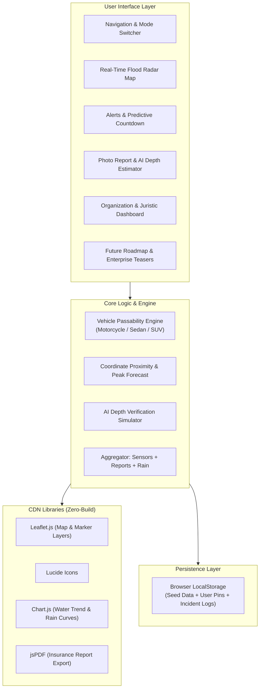
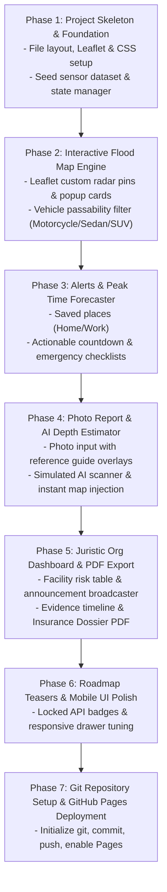

# FloodMate Web MVP — Architecture & Implementation Plan

> [!NOTE]
> **FloodMate** is a street-level flood intelligence and emergency action platform built as a zero-build client-side Progressive Web App (PWA) ready for immediate deployment on **GitHub Pages**.

---

## 1. System Architecture & Tech Stack

GitHub Pages serves static assets without a Node.js/backend runtime. To fulfill all user requirements with high interactivity and data persistence, FloodMate uses a robust client-side architecture:



### Technology Selections
* **Markup & Styling**: Semantic HTML5, CSS3 with modern CSS custom properties (variables), Flexbox/Grid, and responsive mobile-first drawers.
* **Map Engine**: [Leaflet.js](https://leafletjs.com/) via CDN with dark/radar CartoDB or OpenStreetMap tiles.
* **Visual Identity**: Flood Radar theme (deep navy `#0B132B`, ocean radar blue `#0077B6`, caution amber `#FFB703`, emergency crimson `#E63946`, safe mint `#2A9D8F`).
* **Visual Charts**: Chart.js for 12-hour historical water level trends and upcoming peak forecast curves.
* **State & Persistence**: `LocalStorage` API to simulate persistent backend operations (storing user submitted reports, custom pinned locations, juristic broadcast logs).
* **PDF Engine**: Client-side `window.print` with print-specific `@media print` stylesheets or `jspdf` CDN for generating clean insurance claim summary dossiers.

---

## 2. Feature Specifications & Engineering Breakdown

### Specification 1: Flood Radar Visual Identity
* Radar sweep radar pulse header indicator showing "LIVE SCAN ACTIVE".
* Color-coded status hierarchy:
  * 🟢 **Normal / Dry (< 10 cm)**
  * 🟡 **Minor Waterlogging (10 – 20 cm)** — Caution for motorcycles
  * 🟠 **Moderate Flooding (20 – 35 cm)** — Sedans impassable
  * 🔴 **Severe / Critical (> 35 cm)** — Only high-clearance SUVs or closed to all

### Specification 2: Street-Level Flood Map & Passability Calculator
* Interactive marker pins with pulsing animation according to flood severity.
* Marker metadata popup:
  * Measured Depth in centimeters (cm).
  * Trend indicator (`Rising ▲ +4 cm/hr`, `Falling ▼ -2 cm/hr`, `Stable ─`).
  * Confidence Score (`94% - Multi-sensor verified`, `72% - Crowdsourced`, etc.).
  * Data Sources: Sensor ID, rainfall gauge, and validated user reports.
* **Vehicle Passability Status Matrix**:
  * **Motorcycle**: Limit 15 cm.
  * **Sedan / Hatchback**: Limit 25 cm.
  * **SUV / Pickup**: Limit 40 cm.
  * Dynamic toggle filter on map: *"Show passability for my vehicle: [Motorcycle | Sedan | SUV]"*.

### Specification 3: Saved Coordinates & Predictive Peak Warnings
* User coordinates store (Home, Office, Parked Car).
* Real-time distance calculation to the nearest flood zone.
* **Actionable Peak Countdown**:
  * Forecast formula calculating estimated time to peak based on rainfall rate and upstream sensor velocity.
  * Highlight banner: `⚠️ Critical: Water expected to peak at 38 cm in 75 minutes. Recommended Action: Move sedan parked on Soi 23 to higher ground now.`
  * Step-by-step checklist: Disconnect ground appliances, move vehicle, seal door sandbags.

### Specification 4: Photo-Based Flood Reporting with AI Depth Guide
* Clean photo upload / camera interface.
* **Visual Reference Overlay Guide**: Visual guide showing reference heights:
  * *Tire Rim*: ~15 cm
  * *Wheel Hubcap*: ~30 cm
  * *Tire Top*: ~65 cm
  * *Human Ankle*: ~10 cm | *Knee*: ~45 cm
* **AI Depth Estimation Verification Flow**:
  * Interactive simulated analysis step with scanning animation.
  * Generates estimated depth (e.g. `28 cm ± 3 cm`) and confidence index (`High: 88%`).
  * Auto-injects verified report directly into local map data and alerts nearby users.

### Specification 5: Organization & Juristic Dashboard
* Segmented view for Condo Juristic Offices, Fleet Managers, and Parking Lot Operators.
* Risk points monitor (e.g., *Basement B1 Ramp*, *North Drainage Gate*, *Access Road*).
* Broadcast alert generator (publishes notification to simulation banner).
* **Incident Evidence Timeline**: Chronological audit log with timestamps, depths, and actions taken.
* **PDF Claim Export**: 1-click export of structured report for insurance adjusters.

### Specification 6: Future Roadmap Placeholders
* Clean, non-intrusive preview section with badge tags (`Enterprise Only`, `Q3 Roadmap`):
  * **Fintech & Insurance API**: Instant payout claim dispatch integration.
  * **Property Flood Risk Score**: Historical 10-year flood risk index rating for real estate valuation.

---

## 3. Project Directory Structure

```
floodmate_app_3/
├── index.html              # Main single-page application shell
├── css/
│   ├── style.css           # Core theme, radar animations, layout
│   └── components.css      # Modals, drawers, map controls, dashboard
├── js/
│   ├── app.js              # Main coordinator & tab navigation
│   ├── state.js            # LocalStorage state manager & seed dataset
│   ├── map.js              # Leaflet.js integration, layers & marker pins
│   ├── passability.js      # Vehicle passability logic & calculations
│   ├── alerts.js           # Geofence alerts & peak water countdown logic
│   ├── report.js           # Photo upload, reference guide & AI simulator
│   ├── org-dashboard.js    # Juristic dashboard, incident logs & PDF export
│   └── mock-data.js        # Realistic initial flood sensors, coordinates & rain data
├── assets/
│   ├── icons/              # Favicon, vehicle SVG icons, reference markers
│   └── images/             # Sample flood reference images for demonstration
└── README.md               # Documentation and GitHub Pages deployment guide
```

---

## 4. Step-by-Step Implementation Roadmap



| Phase | Milestone | Expected Deliverable |
| :--- | :--- | :--- |
| **Phase 1** | Foundation & Radar Theme | Base HTML5/CSS3 scaffold with radar visual identity, Leaflet CDN imports, and state management. |
| **Phase 2** | Real-Time Map & Vehicle Passability | Interactive map displaying water levels (cm), trends (▲/▼), confidence %, and vehicle passability filters. |
| **Phase 3** | Alerts & Forecasting Engine | Location coordinate management, proximity flood detection, peak time estimation, and vehicle evacuation warnings. |
| **Phase 4** | Photo Reporting & AI Depth Scanner | User reporting modal with tire/curb visual guide and simulated neural depth estimation with instant map pin update. |
| **Phase 5** | Organization Dashboard & PDF Export | Juristic operator view, building risk points, emergency broadcast triggers, and printable insurance claim dossier. |
| **Phase 6** | Enterprise Roadmap & Mobile Polish | Enterprise API placeholders, responsive layout optimization for mobile devices, and dark-mode radar styling. |
| **Phase 7** | GitHub Pages Deployment | Git repository initialization, remote configuration, deployment verification, and testing live links. |

---

## 5. Deployment Workflow to GitHub Pages

Once the files are coded and verified locally:
1. Initialize local git repository:
   ```bash
   git init
   git add .
   git commit -m "feat: initial FloodMate MVP release"
   git branch -M main
   ```
2. Link to user's GitHub repository:
   ```bash
   git remote add origin https://github.com/<username>/floodmate.git
   git push -u origin main
   ```
3. Enable GitHub Pages:
   * **Settings** > **Pages** > **Source**: `Deploy from a branch` (`main` / `/root`).
   * The live MVP will be accessible at: `https://<username>.github.io/floodmate/`.
